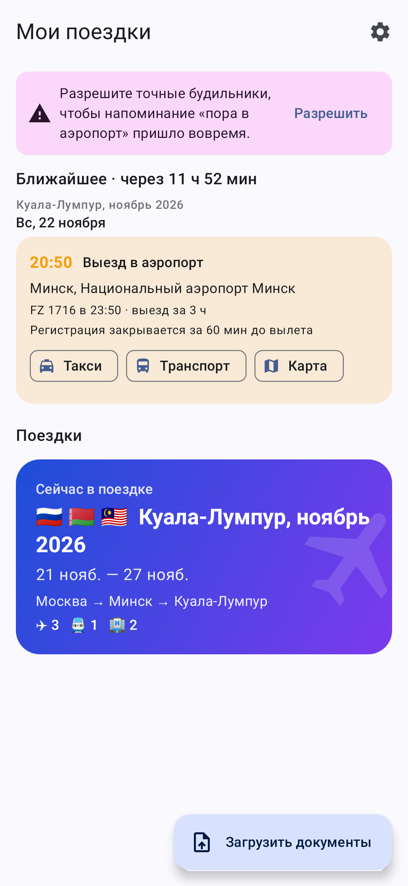
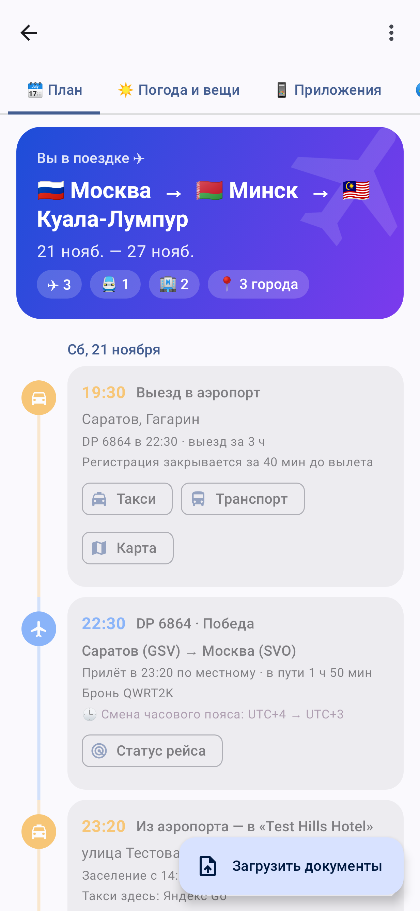
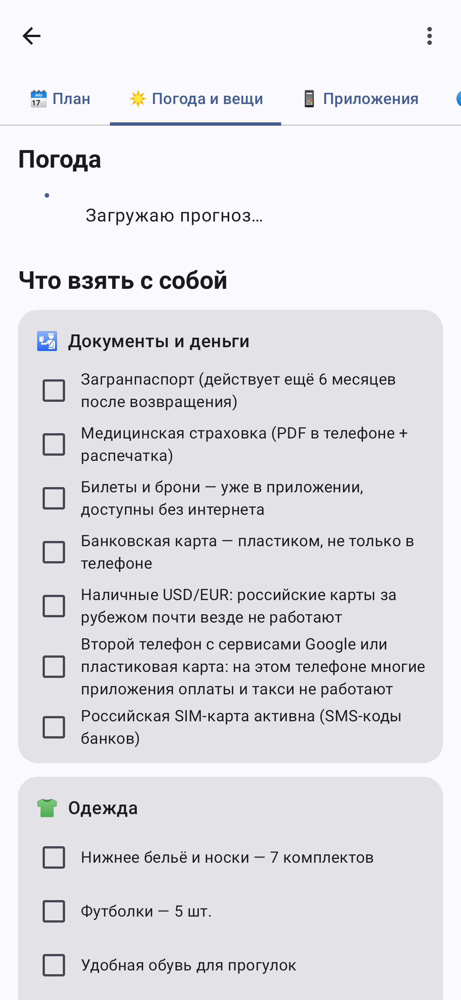

# Мои поездки — планировщик путешествий для Android

Все перелёты, отели, адреса и время выезда собраны в одном месте.

## Как выглядит

| Главная | План поездки | Вещи | Приложения |
|---|---|---|---|
|  |  |  |  |

Скриншоты обновляются командой `./gradlew testDebugUnitTest --tests '*ScreenshotTest*' -Pscreenshots=true -Proborazzi.test.record=true`.

## Что умеет

- **Одна кнопка «Загрузить документы».** Можно сразу отметить много файлов: авиабилеты, ЖД-билеты,
  брони отелей (PDF, скриншоты, фото, текст письма) или «Поделиться» ими из почты и мессенджеров.
  Приложение само:
  - определяет тип каждого документа (перелёт, поезд, жильё);
  - пропускает копии одного и того же файла и уже добавленные рейсы;
  - раскладывает пункты по поездкам по датам: пункты с разрывом больше 3 суток идут в разные поездки,
    пересечение с уже существующей поездкой добавляет пункты в неё;
  - называет поездку по назначению, например «Куала-Лумпур, ноябрь 2026»;
  - добавляет каждый пункт в календарь телефона и ставит напоминания;
  - пункты, где чего-то не хватает, показывает в отчёте с кнопкой «Дополнить» (поля уже заполнены).
- **Распознаются:** маршрутные квитанции авиакомпаний и агентств (в том числе блоки «ВЫЛЕТ:/ПРИЛЁТ:»,
  пересадки), посадочные со штрихкодом (IATA BCBP), контрольные купоны РЖД (поезд, вагон, место,
  местное или московское время), брони отелей (даты, адрес, телефон, номер брони).
  Распознавание работает **на телефоне** (ML Kit + PDFBox), без отправки данных в интернет.
- **План поездки по дням:** выезд в аэропорт или на вокзал → перелёт или поезд → дорога в отель → заселение → выезд.
  У пунктов есть кнопки «Маршрут» (открывает карты) и «Позвонить». Время везде местное, смена часового пояса отмечается.
- **Напоминания:** «Пора в аэропорт» (по умолчанию за 3 ч), «Пора на вокзал» (за 1,5 ч),
  «Открыта онлайн-регистрация», «Сегодня заселение», «Сегодня выезд из отеля». После перезагрузки телефона восстанавливаются.
- **Календарь:** каждый перелёт, поезд и проживание попадает в системный календарь с напоминаниями.
- **Авиакомпании (56)** и **страны (33):** багаж, регистрация, что нельзя везти, въезд, валюта, связь и интернет.
- **Погода и вещи:** прогноз в каждом городе маршрута на даты пребывания (Open-Meteo; для далёких дат — погода
  в эти дни год назад) и список вещей, который собирается сам: одежда по температуре и дождям, розетки, аптечка,
  документы, особенности страны.
- **Приложения по стране:** такси, карты, транспорт, оплата, связь — с кнопками Google Play / App Store
  и «Открыть», если уже установлено. Советы по оплате для российских карт и предупреждение для телефонов
  без сервисов Google (Huawei): взять пластик или второй телефон.
- **Такси и транспорт в каждой точке:** открывается самое популярное такси страны (Яндекс Go, Grab, Careem,
  BiTaksi, Uber…), для Яндекс Go и Uber — сразу с маршрутом «аэропорт → отель»; общественный транспорт —
  в Яндекс Картах (СНГ) или Google Картах.
- **Время выезда из отеля** считается по расстоянию до вокзала/аэропорта (пешком или такси) + запас.
- **Статус рейса** (Flightradar24) и **«Поделиться планом»** текстом.
- **Сборы и документы:** чек-лист сборов и все загруженные файлы поездки, доступные офлайн.

## Сборка

Нужны JDK 17+ и Android SDK (platform 35).

```bash
cd TravelPlanner
./gradlew assembleRelease      # app/build/outputs/apk/release/app-release.apk
./gradlew testDebugUnitTest    # тесты распознавания и сборки поездки
./gradlew testDebugUnitTest -Pticket.pdf=/путь/к/билету.pdf   # проверить разбор своего PDF
```

APK также собирается в GitHub Actions (workflow «TravelPlanner Android»). Готовый файл лежит в артефактах запуска.

## Структура

| Пакет | Назначение |
|---|---|
| `importer` | извлечение текста (PDF, OCR, штрихкоды), разбор билетов, IATA BCBP |
| `data` | Room: поездки, перелёты, жильё; репозиторий и настройки |
| `reminders` | будильники и уведомления, восстановление после перезагрузки |
| `calendar` | запись событий в системный календарь |
| `reference` + `assets/*.json` | справочники аэропортов (с часовыми поясами), авиакомпаний, стран |
| `ui` | экраны на Jetpack Compose |

Справочники лежат в `app/src/main/assets/*.json`, их легко дополнять.
Правила авиакомпаний и стран меняются, поэтому в приложении у каждой справки есть пометка
«сверьтесь с сайтом перед поездкой».
